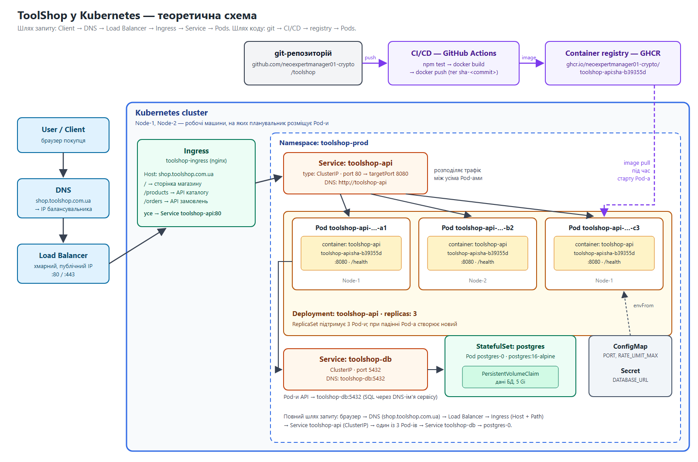

# Практична 9: Теоретична схема Kubernetes-додатку

## 1. Сервіс

Моделюю **toolshop-api** — API інтернет-магазину інструментів ToolShop (Node.js + Express, образ з
практичних 6–7). Він віддає сторінку магазину, каталог товарів (`/products`) і приймає замовлення (`/orders`),
дані зберігає в PostgreSQL. Користувачі — покупці, які через браузер переглядають каталог і оформлюють замовлення.

## 2–4. Схема

Джерело: [k8s-scheme.svg](k8s-scheme.svg).

| Сутність | У схемі |
|----------|---------|
| Cluster | один кластер Kubernetes (великий синій прямокутник) |
| Node | Node-1, Node-2 — машини, між якими розподілені Pod-и (підписано під кожним Pod-ом) |
| Namespace | `toolshop-prod` — усі ресурси магазину |
| Ingress | `toolshop-ingress`: Host `shop.toolshop.com.ua`, шляхи `/`, `/products`, `/orders` → Service `toolshop-api:80` |
| Service | `toolshop-api` (ClusterIP, 80 → 8080) перед API; `toolshop-db` (ClusterIP, 5432) перед базою |
| Deployment | `toolshop-api`, `replicas: 3`, образ `ghcr.io/neoexpertmanager01-crypto/toolshop-api:sha-b39355d` |
| Pods | 3 Pod-и API (у кожному контейнер `toolshop-api`, порт 8080, перевірка `/health`) + `postgres-0` |
| StatefulSet + PVC | PostgreSQL з постійним томом, щоб дані не зникали при перезапуску Pod-а |
| ConfigMap / Secret | налаштування (`PORT`, `RATE_LIMIT_MAX`) і пароль до БД (`DATABASE_URL`) → у контейнери через `envFrom` |
| git → CI/CD → registry | GitHub → GitHub Actions → GHCR; Pod-и завантажують образ з GHCR під час старту |

## 5. Опис дизайну

Сервіс **toolshop-api** живе в namespace **`toolshop-prod`**. Зовнішній трафік приходить на домен
**`shop.toolshop.com.ua`**: DNS вказує на публічний IP хмарного **Load Balancer**, той передає запит в
**Ingress**, який за Host і Path (`/`, `/products`, `/orders`) направляє його на **Service `toolshop-api`**
(ClusterIP), а Service розподіляє запити між Pod-ами Deployment-а; API звертається до бази через внутрішній
DNS-ім'я `toolshop-db`. Закладено **3 Pod-и API** на двох Node: якщо один Pod чи навіть ціла Node впаде,
решта продовжить обслуговувати покупців, а ReplicaSet автоматично створить заміну; база — один Pod
StatefulSet-а з PersistentVolumeClaim. Код живе в **git** (GitHub), після `git push` **CI/CD** (GitHub Actions)
проганяє тести, збирає Docker-образ і пушить його в **registry** (GHCR) з тегом `sha-<commit>`; оновлення —
це зміна тегу образу в Deployment, після чого Kubernetes поступово замінює Pod-и, і кожен новий Pod
завантажує образ із GHCR під час старту.

**Повний шлях запиту:**
Client → DNS (`shop.toolshop.com.ua`) → Load Balancer → Ingress (Host + Path) → Service `toolshop-api` → Pod
(→ Service `toolshop-db` → `postgres-0`).
