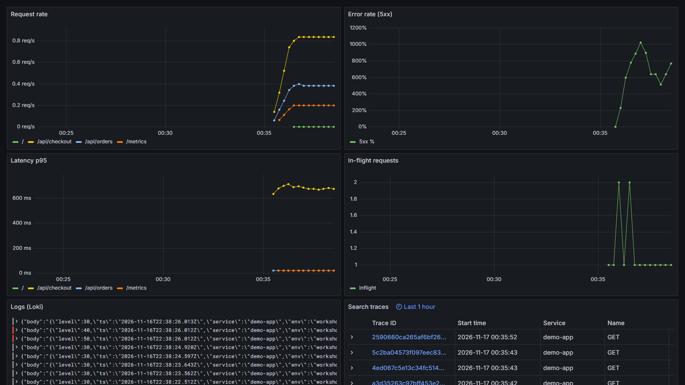
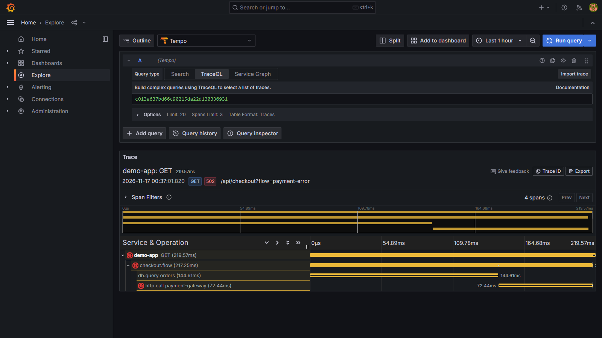
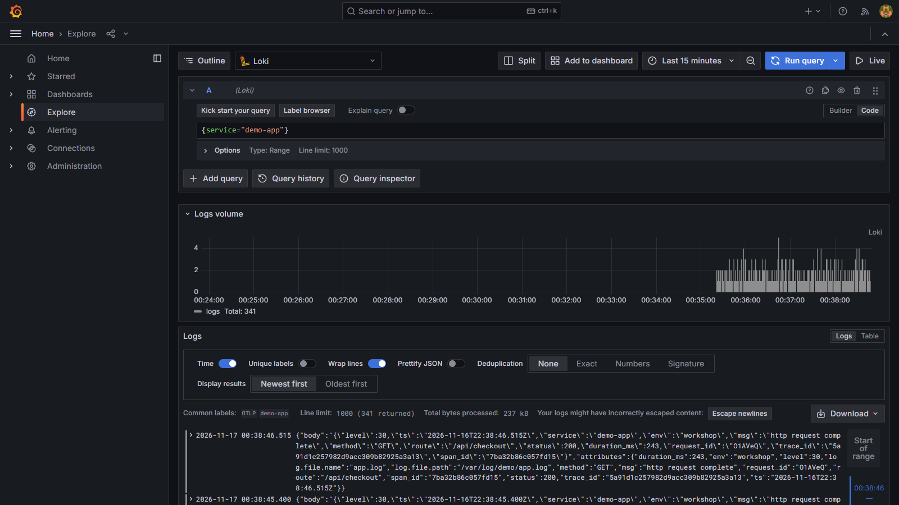
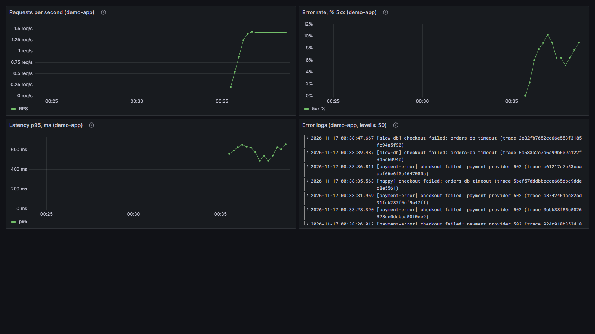

# Практична 8: Observability — Grafana, Loki, Tempo, OpenTelemetry

Виконано рівні **60** (запуск стенда, RED / трейси / логи) і **75** (власний RED-дашборд на наявних даних).

Стенд: [vivalafit/observability-demo](https://github.com/vivalafit/observability-demo), запуск:

```bash
git clone https://github.com/vivalafit/observability-demo.git
cd observability-demo
docker compose up -d --build
```

Усі сервіси відкриваються: API `:3000` (200), Grafana `:3001` (200), Prometheus `:9090` (ready),
Loki `:3100` (ready), Tempo `:3200` (ready). Навантаження генерує контейнер `loadgen`.

---

## 60 балів

### RED-дашборд «Observability Demo / RED»



Сервіс `demo-app` обробляє ≈ 1,4 запиту/с, найбільше — `/api/checkout`. p95 для `/api/checkout` ≈ 600–650 мс,
решта маршрутів відповідає швидко. Панель Error rate показує частку помилок 5xx; у перші хвилини після старту
вона стрибала понад 100 %, бо у вікні `[1m]` ще замало точок і два різні лічильники (`http_requests_error_total`
та `http_requests_total`) екстраполюються по-різному, — після прогріву значення стабілізується (≈ 8 %).

### Трейс у Tempo



Відкрито трейс невдалого запиту `GET /api/checkout?flow=payment-error` (статус 502, 219 мс) — його `trace_id`
взято з error-логу в Loki. Видно 4 спани: `demo-app GET` → `checkout.flow` → `db.query orders` (145 мс) і
`http.call payment-gateway` (72 мс, з помилкою) — тобто збій саме у виклику платіжного шлюзу.

### Логи в Loki



Запит `{service="demo-app"}` за 15 хв повертає 341 рядок. Кожен лог — JSON з рівнем (`level`), маршрутом,
статусом, тривалістю й `trace_id`, тож від будь-якого рядка можна перейти до відповідного трейсу.

---

## 75 балів — власний дашборд «My Demo RED»



JSON дашборду (експорт із Grafana): [my-demo-red-dashboard.json](my-demo-red-dashboard.json).
Імпорт: Grafana → Dashboards → New → Import → завантажити файл.

Усі панелі використовують глобальний період дашборду (за замовчуванням останні 15 хв) і `$__rate_interval`,
тож зміна часу вгорі впливає на всі 4 панелі одночасно.

| Панель | Запит | Що показує і як користуватися в проді |
|--------|-------|----------------------------------------|
| **Requests per second** | `sum(rate(http_requests_total{service="demo-app"}[$__rate_interval]))` | **Rate** — навантаження на сервіс. Різке падіння до нуля = сервіс недоступний або зламався маршрутизатор; різкий ріст — пікове навантаження чи атака. |
| **Error rate, % 5xx** | `100 * sum(rate(http_requests_total{service="demo-app",status_code=~"5.."}[$__rate_interval])) / sum(rate(http_requests_total{service="demo-app"}[$__rate_interval]))` | **Errors** — частка відповідей 5xx. Чисельник і знаменник з однієї метрики, тому значення завжди 0–100 %. Червона лінія — поріг 5 %: перевищення означає, що користувачі масово бачать помилки. |
| **Latency p95, ms** | `histogram_quantile(0.95, sum by (le) (rate(http_request_duration_ms_bucket{service="demo-app"}[$__rate_interval])))` | **Duration** — 95 % запитів швидші за це значення. Середнє ховає повільні запити, а p95 показує, що відчувають «невдачливі» користувачі; ріст p95 — перший сигнал перевантаження БД чи зовнішнього сервісу. |
| **Error logs (level ≥ 50)** | `{service="demo-app"} \| json \| line_format "{{.body}}" \| json \| level >= 50 \| line_format "[{{.flow}}] {{.msg}}: {{.err_message}} (trace {{.trace_id}})"` | Лише логи рівня error (pino `level` 50) сервісу `demo-app`, у короткому вигляді: сценарій, повідомлення, причина й `trace_id`. Коли на графіку Errors сплеск — тут одразу видно причину (`payment provider 502`, `orders-db timeout`) і trace для детального розбору в Tempo. |

**Чому в LogQL два `json`:** колектор OTEL кладе оригінальний JSON-лог застосунку в поле `body`, тому спершу
розбираємо зовнішній JSON, підставляємо `body` як рядок (`line_format`) і розбираємо вже його — після цього
доступні поля `level`, `msg`, `err_message`, `trace_id`.
